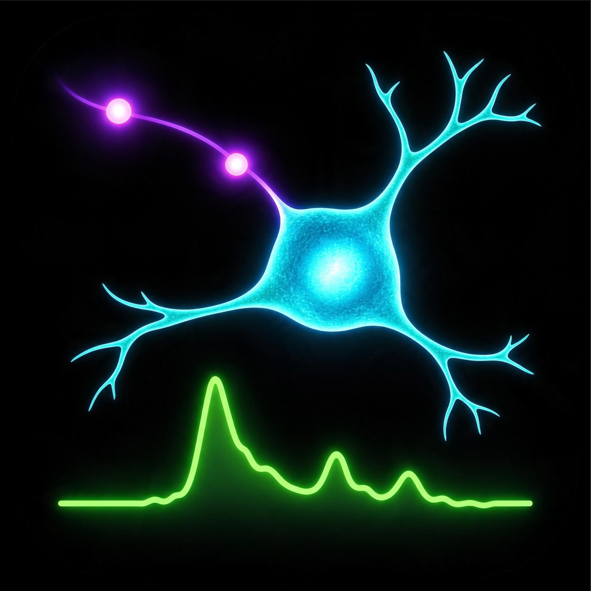

# TwoPhoton Studio



A Windows desktop workflow for two-photon calcium imaging, built around Suite2p.
**Source distribution 0.0.1**, based on the Studio 1.3.4 workflow.
[中文安装教程](README_zh.md) · [Dependencies](docs/DEPENDENCIES.md) · [Third-party notices](THIRD_PARTY_NOTICES.md)

Supports multi-stack single-FOV TIFF import, registration, optional SUPPORT denoising,
Suite2p / Cellpose-SAM / PROFILE ROI candidates, manual ROI review, neuropil correction,
deconvolution, synchronization MAT files, trial-response heatmaps and MATLAB FIG export.
The interface is in English.

## Install on Windows x64

1. Install [Miniforge](https://github.com/conda-forge/miniforge#miniforge3), Miniconda or Anaconda.
2. Download this repository using **Code → Download ZIP**, extract the complete folder
   to a writable local directory such as `D:\TwoPhotonStudio`.
3. Open **Miniforge Prompt / Anaconda Prompt**, change to the extracted directory:
   ```bat
   cd /d D:\TwoPhotonStudio
   python install.py --device cuda
   ```
   No NVIDIA GPU, or prefer CPU?
   ```bat
   python install.py --device cpu
   ```
4. Wait for **INSTALLATION COMPLETE**. The first run downloads Python dependencies,
   PyTorch and the 1.23 GB Cellpose-SAM model and executes model checks.
5. Double-click `Launch.cmd`. Alternatively:
   ```bat
   conda activate D:\TwoPhotonStudio\.local\envs\gui
   twophoton-studio
   ```

Install from the source checkout, not `pip install twophoton-studio`: no PyPI release
is claimed. The installer performs an editable local package installation for you.
Do not move the checkout or its Conda environments after installation; install afresh
in the desired destination.

To download using Git instead of a ZIP:

```bat
git clone https://github.com/yjlu2/TwoPhotonStudio.git
cd TwoPhotonStudio
python install.py --device cuda
```

### What is installed?

- **gui**: Python 3.10, Suite2p 0.10.3, NumPy 1.x, PyQt5, TIFF/MAT/plot libraries.
- **models**: Python 3.11, Suite2p 1.0.0.1, Cellpose 4.0.8 (Cellpose-SAM),
  PyTorch 2.7.0, TorchVision 0.22.0, PROFILE and SUPPORT dependencies.
- NVIDIA mode installs official **CUDA 12.8 PyTorch wheels**. A working NVIDIA driver
  is required; a separate CUDA Toolkit is not required for these prebuilt wheels.
- PROFILE m124/m110 checkpoints, matching presets, SUPPORT bs1 checkpoint and inference
  code are included. Cellpose-SAM is downloaded from a pinned official Hugging Face
  revision and verified by SHA256.

The split preserves the legacy Suite2p API and avoids mixing NumPy 1.x/2.x and Qt versions.
Keep the pinned versions rather than upgrading either environment in place.
GPU Suite2p registration/extraction run in the models process; legacy functional detection,
baseline correction and deconvolution remain CPU operations.

### MATLAB

MATLAB is assumed to be installed separately. Its executable is found via PATH,
the Windows registry or standard install folders. Specify a custom installation:
```bat
python install.py --device cuda --matlab "D:\MATLAB\R2025b\bin\matlab.exe"
```
You can also set **Settings → Models and environments → MATLAB executable**.
FIG exports and MATLAB registration use MATLAB; the installer does not install MATLAB
or MATLAB Runtime. The MATLAB registration implementation calls the bundled DFT routine.

### Check / repair

```bat
python install.py --check
```

Checks include dependency conflicts (`pip check` during installation), a headless GUI,
Suite2p extraction and deconvolution, a real CUDA kernel in CUDA mode, and forward passes
using all three model checkpoints. Details: `.local/doctor-report.json`.
If installation fails, fix the indicated cause and rerun the **same installation command**;
owned environments and checksum-verified weights are reused. Partial downloads are retried,
never accepted as valid models. The installer refuses to modify unrelated existing environments.

The legacy Suite2p import may print `cellpose did not import`. This refers to its optional
in-process anatomical module; TwoPhoton Studio runs Cellpose-SAM in the separate models
environment, which is checked with an actual model inference.

Use `--env-root "E:\TwoPhotonEnvs"` to put environments on another drive; source, models,
logs and configuration stay in this checkout's `.local` directory.
Keep at least 20 GB of free space for a CUDA installation and download caches; the exact
size depends on package versions and Conda. This is a budget, not a measured requirement.

See [Chinese guide](README_zh.md) for full troubleshooting and [validation](VALIDATION.md)
for what has actually been tested.

## Use

Import TIFF stacks from one FOV → Register / Denoise → Detect / Merge ROIs →
review or manually add cells → Compute traces → import sync MAT → export / analyze.
Defaults: **23.2 Hz**, **tau 1 s**. Input data must be single-plane, single-channel.
Update frame rate and synchronization columns to match the experiment.

Only open trusted session NPY files and model checkpoints. Session files use Python object
serialization. The installer verifies bundled/checkpoint checksums before checking models.

## License and citation

TwoPhoton Studio code is **GPL-3.0-only**. Third-party code, models and MATLAB routines
retain their own notices and licenses; see [THIRD_PARTY_NOTICES.md](THIRD_PARTY_NOTICES.md).
Cite Suite2p, Cellpose-SAM, PROFILE, SUPPORT and the DFT registration algorithm when you use
those methods. This project does not claim to be an official distribution of those projects.

